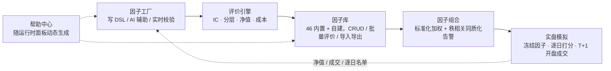
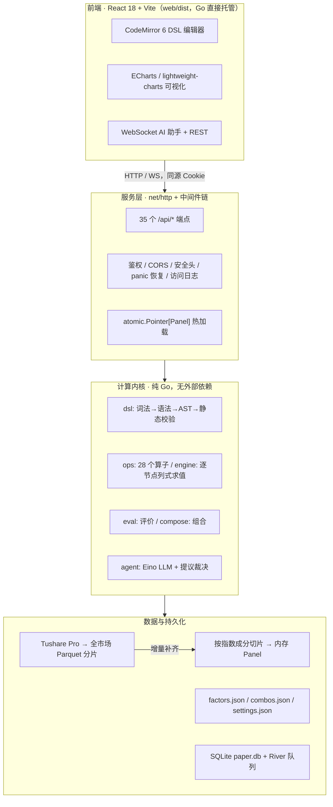
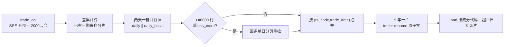
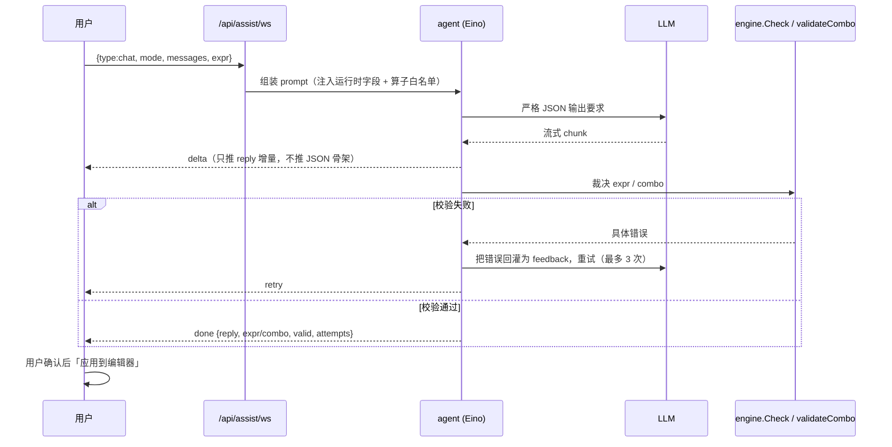
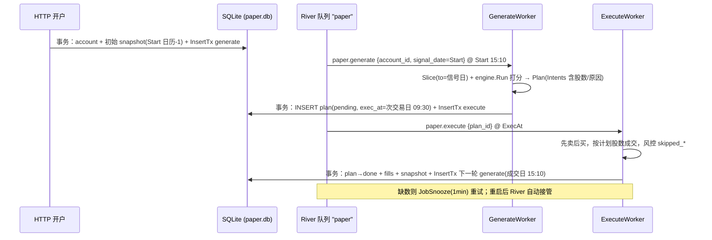

# factor-lab 技术概览（对外展示版）

> **文档性质**：面向其他团队的系统介绍与技术交流材料，用于快速理解「这套系统是什么、怎么搭的、哪些设计值得借鉴、边界在哪里」。
> **基准版本**：2026-11-22 工作区代码状态（`go 1.26.1`）。
> **可信度约定**：本文所有数字与行为均以**真实代码**和**本机实测**为准，关键结论标注来源（文件:行号 / 实测命令）。README 与代码不一致处已在 §12.3 单独列出，不以文档描述代替实现事实。

---

## 目录

| 章节 | 内容 |
|---|---|
| 1 | 项目定位与研究闭环 |
| 2 | 系统架构与技术栈 |
| 3 | 数据层：真实行情、PIT 与全市场 Parquet 缓存 |
| 4 | 因子语言与计算内核 |
| 5 | 评价与组合：口径锁死 |
| 6 | AI 辅助：提议 / 裁决分离 |
| 7 | 实盘模拟：任务化的 T+1 撮合 |
| 8 | 前端工程 |
| 9 | 服务端：API、安全与运维 |
| 10 | 质量、性能与实测数据 |
| 11 | 已知边界与演进路线 |
| 12 | 快速复现、目录结构、术语表、附录 |

---

## 1 项目定位与研究闭环

### 1.1 一句话定位

**factor-lab 是一个单机可部署的 AI 辅助 A 股因子研究平台**：研究者用一门受限的领域语言（DSL）写因子表达式，系统在真实 A 股行情上做静态校验、前向收益评价、分层回测、因子组合与纸上模拟交易；AI 只负责「把自然语言翻译成候选表达式」，**不参与打分、不接触评价口径、不写库**。

### 1.2 要解决的问题

| 痛点 | 本系统的做法 |
|---|---|
| 研究脚本散落、口径各写各的 | 一套 DSL + 一个执行器 + 一个评价引擎，全站共用同一套样本、空值与收益对齐规则 |
| 前视偏差、除权假信号、ST 污染 | 数据层统一做后复权、PIT 财务展开、按日剔除 ST，研究侧无法绕过 |
| 「回测很漂亮、上线就失效」 | 评价口径写死（T+1 收盘执行、分层 10 组、单边 0.3% 成本、全市场等权基准），并对退化截面做隔离 |
| LLM 写因子不可信 | 提议 / 裁决分离：模型输出必须过 `engine.Check`，失败把错误回灌进下一轮重试 |
| 模拟盘「打开页面重跑一遍历史」 | 改为持久化任务队列：一天一份计划、一次成交、账本只追加，重启可恢复 |

### 1.3 研究闭环（五个页面）



前端共 5 个页面（因子工厂 / 因子库 / 因子组合 / 实盘模拟 / 帮助），自写 Hash 路由，无路由库（`web/src/App.tsx:13-19, 71-82`）。

---

## 2 系统架构与技术栈

### 2.1 分层架构



**部署形态**：单进程单二进制（Windows 下 `factor-lab.exe` + `web/dist` 静态资源），无需中间件、无需独立数据库服务。桌面双击 `start.bat` 即可启动生产模式（`start.bat:1-45`）。

### 2.2 技术栈

| 层 | 选型 | 版本 / 说明 |
|---|---|---|
| 后端 | Go | 1.26.1；仅用标准库 `net/http`（Go 1.22+ 方法路由） |
| LLM 接入 | CloudWeGo Eino | `eino v0.9.22` + `eino-ext/components/model/openai v0.1.13`，OpenAI 协议兼容端点（DeepSeek 等） |
| 实时通信 | gorilla/websocket | 1.5.3，仅 AI 助手一处使用 |
| 行情 SDK | tushare-go-sdk | 本地副本 `third_party/`，`go.mod` 用 `replace` 指向，与上游一致 |
| 列式存储 | parquet-go | v0.32.1 |
| 任务队列 | River | v0.51.2 + `riversqlite` driver |
| 数据库 | modernc.org/sqlite | v1.62.0，纯 Go 无 CGO；WAL + 外键 + 单连接 |
| 前端 | React 18.3 + TypeScript 5.5 + Vite 5.4 | `tsc --noEmit && vite build` |
| 编辑器 | CodeMirror 6 | `@uiw/react-codemirror` + `@codemirror/*` + `@lezer/highlight` |
| 图表 | ECharts 5.5 / lightweight-charts 4.2 | 前者回测与净值，后者 K 线蜡烛图 |
| 文档渲染 | react-markdown 10 + remark-gfm | 帮助中心教材与参考文档 |

**代码规模实测**（`find ... | xargs wc -l`）：Go 14,157 行、TS/TSX 7,726 行，合计约 **21.9k 行**。

---

## 3 数据层：真实行情、PIT 与全市场 Parquet 缓存

数据层是本项目工程含量最高的部分，也是「研究结果可信」的地基。

### 3.1 数据源抽象

```go
type Source interface {
    Name() string
    Load(ctx context.Context) (*panel.Panel, error)
}
type Reporter interface { Report() *LoadReport }   // 可选，暴露数据质量摘要
```

（`internal/data/source.go:11-34`）

| 实现 | 入口 | 状态 |
|---|---|---|
| `TushareSource` | `-data tushare`（默认） | 生产，真实 A 股 |
| `CSVSource` | `-data csv -csv panel.csv` | 保留，用户自带长表面板 |
| `SyntheticSource` | **未注册到服务入口** | 仅供单元测试 |

**生产红线**：模拟数据不能静默降级。未配置 Tushare token 时服务仍启动界面让用户去「设置」填写，但绝不会用假数据算因子（`cmd/server/main.go:125-140`）。

### 3.2 三套价格口径与防前视偏差

`assemblePanel`（`internal/data/tushare.go:531-808`）一次性把原始行情整理成内存面板，关键处理：

| 处理 | 实现 |
|---|---|
| **后复权主列** | `open/high/low/close = raw × (当日 adj_factor / 区间首个非零 adj_factor)`；`pct_chg` 由后复权 close 重算，不用接口原值，除权日不出现假暴跌 |
| **前复权 / 未复权** | 同时保留 `qfq_open/qfq_close`（基准=区间末日）与 `raw_open/raw_close`，供模拟盘撮合与涨跌停判定使用 |
| **PIT 财务** | `fina_indicator` 取 `ann_date + roe`，按公告日升序，每个交易日用移动指针取「`ann_date <= 当日` 的最后一条」。3 月 10 日只会用到当时已公告的数据 |
| **ST 剔除** | `stock_st` 按 `(ts_code, trade_date)` 建集合，ST 当日该股全部量价/估值/ROE 列保持 NaN，不进截面 |
| **字段强校验** | `open/high/low/close/vol/amount` 任一整列无有效值 → 启动失败并指出字段名；不静默出错 |
| **可选数据隔离** | ROE / ST / 停牌 / 涨跌停 / 简称拉取失败不阻断启动，只记入 `LoadReport.OptionalErrs` 并打 warning |
| **数据质量摘要** | `index/codes/dates/from/to/bars/st_rows/st_dropped/roe_rows/has_roe/optional_errors`，随 `/api/health` 暴露 |

> **口径提示**：`qfq_*` 在代码中是**前复权**，`open/close` 主列是**后复权**，两者基准相反；对接时不要混用。

### 3.3 全市场日 K 的 Parquet 增量缓存（2026-11-22 新增）

不再按成分股逐只请求 `daily`/`daily_basic`，改为**按交易日拉全市场落盘，面板按指数切片读取**：



| 设计点 | 实现 | 位置 |
|---|---|---|
| 分片规则 | 2000 起每 5 年一片：`data/parquet/daily/2000-2004.parquet` … | `parquet.go:43-62` |
| 行结构 | `ts_code/trade_date` + 8 个量价列 + 16 个 `daily_basic` 列 = 24 字段；**不写入 `daily_basic.close`**，Close 取 daily 未复权收盘 | `parquet.go:14-41` |
| 增量补齐 | `trade_cal` 全量交易日 − 分片已有日期 = 缺失日；无缺失直接返回，不重写 | `daily_fetch.go:133-199` |
| 截断回退 | 单批 `>=6000` 行或 `has_more` 视为截断，两天窗口拆成单日并走分页 | `daily_fetch.go:41-48, 224-248` |
| 幂等合并 | 以 `(ts_code, trade_date)` 为键，新行覆盖旧行 | `parquet.go:124-146` |
| 原子写盘 | 写 `.tmp` → `rename`；Windows 目标已存在时删目标再 rename | `parquet.go:64-81` |
| 接口级限流 | SDK 按 `api_name` 分键的令牌桶，`500 次/分钟/接口`（≈8.33 QPS，burst 2）+ 3 次重试 | `tushare.go:108-113`、SDK `ratelimit.go:95-122` |
| 故障隔离 | `daily` 失败整体失败；`daily_basic` 失败只 warn 并置 NaN，日 K 仍落盘 | `daily_fetch.go:214-220` |

**本机实测**（`find data/parquet -type f`）：已有 4 个分片 `2000-2004` / `2005-2009` / `2010-2014` / `2015-2019`，合计 **1,886,794,021 B ≈ 1.76 GiB**。

> **注意**：`adj_factor`、`fina_indicator`、`suspend_d`、`stk_limit`、`stock_basic` 仍按成分逐代码请求，未进 Parquet（设计文档明确的「非目标」）。回补起始日恒为 `20000101`，**不受 `-start` 约束**（`daily_fetch.go:138`），首次全量加载耗时较长，启动加载超时设为 3 小时（`main.go:73`）。

### 3.4 内存面板与热加载

`Panel` 是「日期主序展平」的列式结构：一列 = 长度 `T×N` 的 `[]float64`，下标 `i*N+j`，缺失值统一为 NaN（`internal/panel/panel.go:12-24, 68`）。

- **Panel 自身不加锁**，安全性靠上层**整体替换**：`atomic.Pointer[panel.Panel]`，`POST /api/admin/reload` 成功后 `s.p.Store(p)`，在读请求不中断的前提下换掉面板（`server.go:159, 189-190, 531`）。
- 按指数切换股票池时，`ForIndex(index)` 浅拷贝数据源并**共享 Client 与 Parquet 缓存**，服务层用 `ready chan` 做单飞式懒加载缓存（`tushare.go:76-87`、`server.go:698-741`）。
- 静态配置了 14 个 A 股指数，`399300.SZ` 归一为 `000300.SH`；默认沪深300 无成分数据时反向回退到 `399300.SZ`（`data/universe.go:13-51`、`tushare.go:220-240`）。

---

## 4 因子语言与计算内核

### 4.1 DSL

一门**受限、可静态校验**的表达式语言，而非通用脚本：

```text
# 中间变量 = 赋值；最后一行（赋值或裸表达式）的值即因子值
mom20 = close / ts_delay(close, 20) - 1
alpha = -1 * cs_rank(mom20)

# 条件；if 是注册算子，不是控制流关键字
down  = if(pct_chg < 0, ts_std_dev(pct_chg, 20), close)
alpha = cs_rank(ts_arg_max(down * down, 5)) - 0.5
```

- 语法：`program := stmt (';' | 换行) stmt ...`，支持 `#` 注释、科学计数法、比较/逻辑运算、括号；优先级 8 级（`dsl/parser.go:10-22`）。
- AST 7 类节点（`dsl/ast.go`）；`Parse` 与 `Validate` 返回**错误列表**而非首错即停，靠 `recover()` 跳到语句边界聚合错误。
- 静态校验硬约束：算子白名单、参数个数、**常数位必须是 1~512 整数**（窗口长度）、字段/变量先定义后使用、变量名不得与字段重名、嵌套深度 ≤ 64。
- 错误形态为统一中文串 `第N行: ...`，`POST /api/check` 返回 `{"ok":bool,"errors":[]string}`。

### 4.2 算子库（实测 28 个）

| 类别 | 数量 | 名称 |
|---|---|---|
| `ts_*` 时序（沿单股时间轴滚动，窗口必填） | 13 | `ts_delay` `ts_delta` `ts_sum` `ts_mean` `ts_std_dev` `ts_max` `ts_min` `ts_arg_max` `ts_rank` `ts_zscore` `ts_decay_linear` `ts_corr` `ts_cov` |
| `cs_*` 截面（每个交易日横截面） | 4 | `cs_rank` `cs_zscore` `cs_demean` `cs_scale` |
| 数学 / 逻辑 | 11 | `abs` `log` `sqrt` `sign` `power` `max` `min` `if` `and` `or` `not` |

> `and/or/not` 是词法关键字，实际以运算符形式生效，帮助文档会从「可调用函数」中排除，因此对外暴露 25 个算子文档（`api/help.go:132-153`）。README 中「11 / 4 / 10」为过时数字。

### 4.3 执行引擎与 NaN 约定

- `engine.Run`：`Parse → Validate → exec`。**每个 AST 节点都产生一条完整列向量**（长度 `T×N`），无公共子表达式消除、无表达式级缓存；常数位跳过求值直接传给算子。
- `engine.Check`：只做 Parse + Validate，不读任何字段值 → 也是 AI 提议的裁决入口。
- 变量作用域是单一平坦 map，按语句顺序写入，先定义后使用。
- **NaN 语义统一**（`ops/registry.go:1-7`）：算术任一 NaN → NaN；比较/逻辑把 NaN 当假返回 0/1；滚动与截面聚合跳过 NaN、有效样本不足输出 NaN；`if` 的 NaN 条件取假分支。
- 算子系统全部预分配输出列并复用临时切片；计算内核本身**不并发**，并发在 API 层（批量评价 `sem=4`，`server.go:1156-1177`）。

### 4.4 内置经典因子

46 条，启动时一次性播种进 `data/factors.json`（`.seeded` 标记防复活），之后与用户因子**完全平等：可编辑、可删除、可导出**（`api/server.go:209-274`）：

| 分类 | 数量 | 内容 |
|---|---|---|
| alpha101 | 20 | WorldQuant 101 Alphas 可迁移子集，`Desc` 保留论文原式 |
| alpha158 | 7 | Qlib 风格 K 线形态、RSV、乖离率、成交额波动 |
| momentum / reversal | 3 / 3 | 多周期动量、短中期反转、隔夜跳空 |
| volatility / volume | 4 / 4 | 低波异象、波动率期限结构、量价相关、低换手溢价 |
| valuation / quality / size | 5 | E/P、B/P、ROE、稳定 ROE、小市值 |

---

## 5 评价与组合：口径锁死

### 5.1 评价引擎（`internal/eval/eval.go`）

**唯一收益对齐公式**（杜绝前视偏差）：

```text
信号日 t 只用 t 及以前数据；t+1 收盘执行；持有 Horizon 个交易日
fwd_ret(t) = close(t+1+H) / close(t+1) - 1
lastSignal  = T - 2 - H
```

| 参数 | 默认值 | 可否经 API 覆盖 |
|---|---|---|
| `Horizon` 持有期 | 1 | 是（≥1） |
| `Groups` 分层数 | 10（因子升序，Q10 = 因子最大） | 是（≥2） |
| `Cost` 单边成本 | 0.003 | 是（≥0） |
| `MinStocks` 最小有效截面 | 5 | **否，固定** |
| 基准 | 全市场等权 | 否 |
| 主结论口径 | **多头净超额**（A 股个人无空头腿），多空仅作研究参考 | 否 |

输出指标：`IC / RankIC` 及其时序、`ICIR / RankICIR`、`t 值`、`P(IC>0)` / `P(IC>0.02)`、分层平均收益与净值、多头毛/净净值、全市场净值、多头净超额、多空、`Coverage`、日均换手与年化成本（`CostAnnual = TurnoverDaily × 2 × Cost × 252`）。

**退化截面隔离**：因子值或收益全相同 → `pearson` 返回 NaN，当日 IC 不计入均值/标准差/t 值，但 `NDates` 与净值照常推进，`ICByDate` 保留 NaN 让前端画缺口；有效股票数 < 5 的整日跳过。有专门回归测试（`eval/eval_test.go:12-43`）。

### 5.2 组合引擎（`internal/compose/compose.go`）

组合不是另起一套计算，而是**生成一段 DSL 再交给同一个引擎**，保证样本、空值规则、评价口径完全一致：

```text
# [1] 因子名  weight=0.5000
p0_mom20 = close / ts_delay(close, 20) - 1
z0 = cs_zscore(-1 * cs_rank(p0_mom20))
alpha = z0 * 0.500000 + z1 * 0.500000
```

- **变量隔离**：每个成分因子的中间变量按 `pN_` 前缀重命名；整词匹配，函数名（如 `ts_delay`）不改名；重复变量名报错。
- **标准化**：每个因子终值做 `cs_zscore`，再乘 `weight × direction` 并按 `Σ|w|` 归一化；上限 20 个成分；任一成分 NaN 则该股组合值 NaN（宁缺毋滥）。
- **同质化检查**：逐日计算两因子截面 Spearman 秩相关再取均值，日样本 < 10 跳过；`> 0.7` 时服务层追加中文告警「高度同质，组合分散效果有限」（`server.go:1282-1319`）。
- 方法枚举：`manual` / `equal`。

---

## 6 AI 辅助：提议 / 裁决分离

这是本项目最值得对外讲的一条架构纪律：**LLM 的输出永远不是可执行结果**。



| 环节 | 约束 |
|---|---|
| 提示词 | 运行时注入 `p.Fields()` 与 `ops.Sigs()`；combo 模式**只给因子库 id/名称/分类/指标，不给表达式**，明令禁止发明因子 |
| 输出解析 | 自研 `extractJSON` 平衡括号 + 字符串感知提取，支持 markdown 围栏与前后文字 |
| 裁决 | factor → `engine.Check`（与 `/api/check` 同一函数）；combo → 白名单校验（id 存在、可用、去重、≥2 个、`method/direction` 合法） |
| 边界 | 全程**不调用 `eval.Evaluate`、不写库、不执行工具**；模型看不到也改不了评价口径 |
| 重试 | `assistMaxRetries = 2`（最多 3 次 LLM 调用），校验错误原文回灌 |
| 流式 | 自研 `replyExtractor` 增量解码 JSON 字符串（断字、UTF-8、`\uXXXX`），只推给用户看的 reply |
| 事件 | `delta` / `retry` / `done` / `error`；`stop` 通过 `cancel()` 中断 |
| 超时与防护 | 单轮 90s、写 deadline 30s、读上限 64KB、messages 1~40 条且单条 ≤4000 字符、每连接 busy 互斥、Origin 白名单 |
| 未配置模型 | 一次性接口与 WS 升级前均返回 **503 + 明确提示去「设置」**，代码中不存在任何模板/规则降级生成器 |

**配置热更新**：支持多模型条目与激活项；密钥只回掩码（`前4 + •••••• + 后4`）；保存时**先用 20s 超时构造新模型成功才落盘并替换**，避免把可用配置覆盖成坏配置；原子写 `0600` 权限（`api/settings.go:169-232`、`agent/settings.go:292-367`）。

---

## 7 实盘模拟：任务化的 T+1 撮合

模拟盘已从「打开页面重跑一遍历史」重构为**持久化、可恢复、幂等**的事件驱动模型（`internal/paper/`）。

### 7.1 五包分层

| 包 | 职责 | 边界 |
|---|---|---|
| `account` | 账户实体（开户时冻结 `Expr` 与 `Config`） | 后续打分/成交只读 |
| `matching` | 纯撮合领域函数 `Generate` / `Execute` | 不碰 DB、不碰队列，两者互不调用 |
| `ledger` | `Book` / `Fill` / `Snapshot` / `Apply` | 只改内存账本 |
| `jobs` | River 任务定义与 worker 编排 | 只做拉数、调用领域函数、事务 |
| `store` | SQLite 持久化，`//go:embed schema.sql` | 领域表，K 线不入库 |

### 7.2 时序（T+1 靠任务衔接，不靠持仓开关）



- **队列**：`riversqlite` driver，官方 migrate 建 `river_*` 表，队列名 `paper`，`MaxWorkers: 1`（SQLite 单写者）；两种任务 `paper.generate` / `paper.execute`，均 `UniqueOpts{ByArgs:true}`。
- **幂等四层**：River ByArgs 去重 + `plan_account_exec_day` 唯一索引（`substr(exec_at,1,10)`）+ `snapshot PRIMARY KEY(account_id,date)` + `UPDATE ... WHERE status='pending'` 条件更新；冲突/已 done 一律空操作返回。
- **缺数自愈**：打分日/成交日 K 不齐 → `JobSnooze(1min)`，不写计划、不改账；CSV 数据源无法 Reload → `JobCancel`；不引入第三种任务、不做 `kick`。
- **GET 只读**：`assemblePaper` 全是 SELECT，不落盘、不入队、不 Reload。

### 7.3 撮合口径

| 规则 | 值 / 行为 |
|---|---|
| 默认配置 | `TopN=10`、`RebalanceThreshold=20`、`Capital=1,000,000`、`Cost=0.003`、`SlippageBps=0` |
| 换仓阈值 | 持仓排名跌出 `TopN + Threshold` 才 `exit`；补位 `enter` 只取 rank ≤ TopN |
| 权重再平衡 | 目标权重偏移 > 3% 触发 `rebalance`；原因只允许 `enter/exit/rebalance`，成交失败原因写 `Fill.Status` |
| 股数估算 | 用**信号日收盘价**估 NAV 与目标市值，分母含滑点与费率，向下取整到 100 股整手 |
| 成交 | 次日 09:30 开盘价；先卖全部再买全部；现金不够每次减 100 股再试，不足 1 手记 `skipped_untradeable` |
| 风控状态 | `filled` / `skipped_suspend` / `skipped_limit_up` / `skipped_limit_down` / `skipped_untradeable`；**不换股票顶替、不重算等权** |
| 账本 | 只追加 `fill` 与 `snapshot`；`account` 表本金与公式永不被成交改写 |

**表结构**：`account` / `plan` / `fill` / `snapshot` 四表 + 唯一索引 + 外键级联 + `PRAGMA journal_mode=WAL` + `foreign_keys=ON` + `SetMaxOpenConns(1)`（`paper/store/schema.sql`）。本机 `data/paper.db` 约 823 KB（另有 WAL）。

---

## 8 前端工程

| 主题 | 实现 |
|---|---|
| 编辑器 | **CodeMirror 6**（非自研 textarea）。自研 `StreamLanguage` 定义 DSL 词法、字段/算子 `snippetCompletion`、`hoverTooltip` 签名提示、`Mod-Enter` 触发评价、状态栏行列/字符数/校验态。文件头注释记录了替换自研双层高亮的原因：Windows 缩放下点击位置与光标错位（`components/CodeEditor.tsx:32-38`） |
| 弹层 | 不用原生 `<select>` / `<input type=date>`；`Popover` **首帧即 `position:fixed`**，按可用空间自动上下展开，统一处理滚动/Esc/外部点击/resize（`components/Popover.tsx:26-81`） |
| 图表 | ECharts 5 出 8 类图：分层回测、分层净值、IC 时序（time 轴 + dataZoom）、多头 vs 全市场、模拟盘净值（买卖三角标记 + 点击钻取当日）、相关性热力矩阵等；lightweight-charts 出个股 K 线蜡烛 + 成交量；卡片迷你净值用手写 SVG |
| 主题 | CSS 变量驱动明暗双主题，首帧内联脚本防闪烁；JS 侧 `cssVar()` 读变量让 ECharts / K 线随主题重绘；**涨红跌绿**（`--up:#f07171` / `--down:#3dd68c`） |
| AI 助手 | WebSocket 连接复用 + 握手失败回退 HTTP `/api/assist` 并复用同一套事件状态机；`busyRef` 防竞态；离线明确提示去设置 |
| 网络层 | 统一 `credentials:'same-origin'`，401 触发全局登录门；令牌只在登录时提交一次，不落 localStorage、不进 URL |
| 工作区 | 因子工厂 / 组合页为 IDE 式多标签，每标签独立表达式与脏标记；AI 面板宽度、股票池选择写 localStorage 并容忍隐私模式写入失败 |
| 帮助中心 | 8 章教材 + 5 篇参考文档用 `?raw` / `import.meta.glob` 编进产物；`GET /api/help` 把**当前运行时面板字段、算子注册表、内置因子**动态插值进文档，避免文档与实现漂移（`api/help.go:108-161`） |

---

## 9 服务端：API、安全与运维

### 9.1 API 全景（35 个端点，`server.go:394-430`）

| 组 | 端点 |
|---|---|
| 元信息 | `GET /api/health` `/api/meta` `/api/stats` `/api/help` |
| 因子计算 | `POST /api/check` `/api/evaluate` `/api/compose` |
| 因子库 | `GET/POST /api/factors`；`GET/PUT/DELETE /api/factors/{id}`；`/copy`；`/batch-evaluate`；`/export` `/import` |
| 组合库 | `GET/POST /api/combos`；`PUT/DELETE /api/combos/{id}`；`POST /api/combos/{id}/evaluate` |
| 模拟盘 | `GET/POST /api/paper`；`GET/DELETE /api/paper/{id}`；`POST /api/paper/{id}/sync`；`POST /api/paper/sync` |
| AI | `POST /api/assist`；`GET /api/assist/ws` |
| 配置 / 会话 | `GET/PUT /api/settings`；`POST /api/settings/test`；`/api/session`（GET/POST/DELETE） |
| 行情 / 运维 | `GET /api/kline?code=`；`POST /api/admin/reload` |

`/api/evaluate` 请求体：`{expr, horizon, groups, cost, start, end, universe}`，其中 `universe` 支持按 14 个指数切换股票池。

### 9.2 中间件链

```text
accessLog → recoverPanic → securityHeaders → auth → cors → mux
```

（`server.go:438`）

| 能力 | 参数 / 行为 |
|---|---|
| 鉴权 | `-api-token` / `FACTOR_LAB_TOKEN`；浏览器用 **HttpOnly Cookie**（`fl_session`，12h，SameSite=Strict），脚本用 `X-API-Token` 头；`health` / `session` 放行；**对外监听未配令牌直接拒绝启动** |
| 登录防爆破 | 同 IP 1 分钟内失败 5 次锁定（进程内计数） |
| 安全头 | CSP、`nosniff`、`SAMEORIGIN`、`Referrer-Policy`；API 响应 `no-store`；CORS 默认同源，需跨域时 `-cors-origin` 显式列白名单 |
| 可观测 | 结构化 JSON 日志 + `X-Request-Id` 回传；访问日志记 `method/path/status/ms/ip`，静态资源不打日志 |
| HTTP 超时 | `ReadHeader 10s` / `Read 60s` / `Write 15min`（首次拉新股票池）/ `Idle 120s` / `MaxHeaderBytes 1MB` |
| 生命周期 | `signal.NotifyContext` + `Shutdown(20s)` 优雅关闭，关闭时一并停 River 队列 |
| 热加载 | `POST /api/admin/reload` 10 分钟超时，成功后原子替换面板并清空股票池缓存；失败只记日志不改面板 |
| 静态资源 | 入口 `no-cache`，`/assets/*` 内容哈希长缓存 |

---

## 10 质量、性能与实测数据

### 10.1 测试（本机实测）

```text
$ go test ./...
ok  factor-lab/internal/agent          ok  factor-lab/internal/api        0.724s
ok  factor-lab/internal/compose 1.866s ok  factor-lab/internal/data      0.646s
ok  factor-lab/internal/dsl            ok  factor-lab/internal/engine    1.906s
ok  factor-lab/internal/eval    1.846s ok  factor-lab/internal/factors  1.835s
ok  factor-lab/internal/ops            ok  factor-lab/internal/paper/jobs
ok  factor-lab/internal/paper/ledger   ok  factor-lab/internal/paper/matching
ok  factor-lab/internal/paper/store
（共 106 个 Test 函数，全部通过；cmd/server 与 panel 无测试文件）
```

覆盖维度：DSL 解析/校验、算子 NaN 边界、Alpha101 端到端、合成数据已知规律 IC、退化截面健壮性、组合拆分与秩相关、46 条内置因子全量校验 + 执行冒烟、AI JSON 提取与流式解码、Parquet 往返与 6000 行回退、Tushare 后复权/PIT/ST 契约（httptest 模拟）、模拟盘 14 个队列用例（含回滚、snooze、幂等、事务）、鉴权与 WebSocket。

另有 12 个 Node 脚本做界面截图与交互回归（`scripts/shot*.mjs` / `verify-*.mjs`，基于 CDP 驱动本机 Chrome，`scripts/shot.mjs`）。

### 10.2 性能基线

⚠️ 下表为 `docs/PRODUCTION.md §5` 记录的 **2026-11-01 真实数据联调结果**，当时数据源为远程服务（现已改为 Tushare Pro + Parquet 链路），仅作量级参考，不代表当前链路实测。

| 规模 | 耗时 |
|---|---|
| 50 只 × 683 日（3.4 万 K 线）加载 | 19.3s |
| **300 只 × 1653 日（47.6 万 K 线）加载** | **2m42s** |
| **46 因子全库评价（300 股 × 1653 日）** | **2.2s**（4 并发） |

真实数据质量：ST 剔除 1,355 条、ROE PIT 记录 36,820 条；全库平均 `|RankIC| = 0.0102`，`|t|>2` 的因子 23/47。

**一条值得对外分享的分析结论**：多个因子出现「RankIC 为正、但多头累计超额为负」（如 `low_amplitude20` IC 0.0316、超额 −65.5%），根因是 300 只股票分 10 层每层仅 30 只，累计超额被少数极端个股主导。**分层累计超额不能单独作为因子有效性判据**，需配合中性化、分组稳健性与多空拆分。

---

## 11 已知边界与演进路线

对外展示时我们刻意保留这一节：**边界写清楚，比只讲优点更便于别的团队判断能否复用**。

### 11.1 架构级边界（`docs/PRODUCTION.md §4`）

| 优先级 | 缺口 | 影响 | 建议 |
|---|---|---|---|
| **P0** | 无用户体系与租户隔离 | C 端用户互相可见因子与会话，无法计费 | 登录（手机号/微信）+ `owner_id` + 查询强制过滤 |
| P1 | 因子库为单机 JSON 文件 | 多实例部署互相覆盖 | 迁移 PostgreSQL / 乐观锁 |
| P1 | 业务接口无速率限制、无监控告警 | 批量评价可打满 CPU，故障靠用户反馈 | 按 token/IP 限流 + `/metrics` |
| P1 | 行情不自动刷新 | 需人工调 reload | 每日收盘后定时任务 + 加载失败告警 |
| P2 | 无审计日志 / 结果缓存 / LLM 成本配额 | 追溯与成本不可控 | 审计表、结果缓存键、按用户配额 |
| P3 | 无 HTTPS | 明文传输 | 由 Nginx/网关终止 TLS |

### 11.2 研究能力边界

- 股票池目前为指数成分（默认沪深300），全 A 股约 5000 只下加载耗时与内存未压测；历史成分使用「最近一期权重」，长区间回测存在成分幸存者偏差。
- `cs_*` 算子缺 `cs_neutralize(factor, industry)`，**未做行业/市值中性化**，IC 中混有风格效应；也未做去极值（winsorize）与分组稳健性检验。
- 评价与撮合均以收盘/开盘单价成交，无 VWAP、无盘中分批撮合。

### 11.3 当前实现注意点（对接前请知悉）

1. `POST /api/paper/{id}/sync` 与 `/api/paper/sync` 目前返回 `204 No Content`，是设计上「不需要第三种任务」的空实现，同步按钮无实际效果；缺数由 worker 每分钟 snooze 自愈。
2. `TopNavNet`（扣成本后的多头净值）当前实现中换手计算比较的是同一份当期持仓，`dailyTurn` 恒为 0，因此与 `TopNav` 数值相同；`TurnoverDaily` / `CostAnnual` 指标本身正确。
3. AI 助手 WS 与一次性接口的 90s 超时为硬编码，不随「设置」里 `TimeoutSec`（可配至 600s）变化。
4. `-tushare-qps` 已废弃，实际生效的是 `-tushare-rpm`（默认每接口 500 次/分钟）；`README.md` 中「11 / 4 / 10 个算子」「自研 textarea 编辑器」「TradingView 日 K」等描述已过时，以本文和代码为准。

---

## 12 快速复现、目录结构、术语表、附录

### 12.1 编译与启动

```bash
# 后端
go build -o factor-lab.exe ./cmd/server

# 前端
npm --prefix web ci && npm --prefix web run build

# 生产启动（真实 A 股数据）
./factor-lab.exe \
  -addr 127.0.0.1:8080 \
  -data tushare -index 000300.SH -topn 0 -start 20200101 \
  -store data/factors.json -web web/dist \
  -api-token "$FACTOR_LAB_TOKEN"

# 验证
go test ./...
curl -s http://127.0.0.1:8080/api/health
curl -X POST -H "X-API-Token: $TOKEN" http://127.0.0.1:8080/api/admin/reload
```

Windows 直接双击 `start.bat`（先编译前后端、自动打开浏览器）。环境变量：`TUSHARE_TOKEN`、`FACTOR_LAB_TOKEN`、`LLM_BASE_URL` / `LLM_API_KEY` / `LLM_MODEL`；`start.bat` 支持 `TUSHARE_INDEX` / `TUSHARE_START` / `TUSHARE_TOPN` 覆盖。Tushare token 与模型也可在界面左下角「设置」里填写，写入 `data/settings.json`，保存即热生效。

### 12.2 目录结构

```text
factor-lab/
├── cmd/server/               入口：flag、优雅关闭、装配依赖
├── internal/
│   ├── data/                 Tushare / CSV / Parquet 日更 / 股票池 / 数据质量摘要
│   ├── panel/                列式内存面板（T×N，NaN 缺失）
│   ├── dsl/ ops/ engine/     语言、算子注册表、执行与静态校验
│   ├── eval/ compose/        评价引擎、因子组合与秩相关
│   ├── factors/              46 条内置经典因子定义
│   ├── agent/                Eino 接入、提示词、流式、配置热更新、提议裁决
│   ├── paper/                account / jobs / matching / ledger / store（五包分层）
│   └── api/                  35 个端点、鉴权、中间件、帮助文档、模拟盘 HTTP
├── web/                      React + Vite 前端（构建产物 web/dist 由 Go 托管）
├── data/                     factors.json / combos.json / settings.json / paper.db
│   └── parquet/daily/        5 年一片的全市场日 K 缓存
├── docs/                     PRODUCTION.md、设计文档、实施计划
├── scripts/                  CDP 截图与交互回归脚本（Node）
└── third_party/              tushare-go-sdk 本地副本
```

### 12.3 术语表

| 术语 | 定义 |
|---|---|
| **Panel（面板）** | 内存中的二维行情表，日期轴 T × 股票轴 N，每字段为长度 `T×N` 的列，缺失值统一 NaN |
| **DSL** | 本项目自研的因子表达式语言；最后一条语句的值即因子值 |
| **时序算子 / 截面算子** | `ts_*` 沿单只股票时间轴滚动（窗口必填 1~512）；`cs_*` 在单个交易日的全部股票横截面上计算 |
| **PIT（Point-In-Time）** | 按公告日 `ann_date` 展开财务数据，保证任一交易日只能看到当时已公开的信息 |
| **后复权 / 前复权** | 主列 `open/close` 为后复权（基准=区间首日）；`qfq_*` 为前复权（基准=区间末日）；`raw_*` 未复权 |
| **前向收益对齐** | `fwd_ret(t)=close(t+1+H)/close(t+1)-1`，信号日 t+1 收盘执行，持有 H 日 |
| **IC / RankIC** | 因子值与前向收益的 Pearson 相关 / 秩相关；ICIR 为 IC 均值除以标准差；t 值为 `ICIR × √N` |
| **退化截面** | 当日因子值或收益全相同（IC 无定义）或有效股票数不足；前者跳过 IC 统计但推进净值 |
| **提议 / 裁决分离** | LLM 只产出候选表达式，是否可执行由 `engine.Check` / 白名单校验决定 |
| **计划（Plan）** | 模拟盘一天一份的交易意图清单，含信号日、成交时刻、买卖股数与原因 |
| **Snooze** | River 任务因数据不齐主动推迟 1 分钟重试，不写任何领域数据 |
| **分片（Shard）** | 全市场日 K 按 5 年一个 Parquet 文件的存储单元 |

### 12.4 文档与代码不一致清单（供维护方回填）

| 位置 | 文档说法 | 代码事实 |
|---|---|---|
| `README.md:189` | DSL 编辑器为自研 textarea 双层、零第三方依赖 | 已改为 CodeMirror 6（`web/src/components/CodeEditor.tsx:27,32-38`） |
| `README.md:54` | 算子 11 / 4 / 10 | 实际 13 / 4 / 11 = 28 |
| `README.md:47` | 点击股票名打开 TradingView 日 K | 应用内 lightweight-charts 自绘，TradingView 仅剩外链 |
| `README.md:80`、`PRODUCTION.md:34` | `-tushare-qps` 全局限流 | 已废弃，生效为 `-tushare-rpm`（每接口 500/min） |
| `README.md:113-139` | API 表 | 未列 `GET /api/help`；`/api/evaluate` 未写 `universe` 参数 |
| `PRODUCTION.md:11` vs `:15` | 关于 `-allow-synthetic` 自相矛盾 | 服务入口只有 `tushare | csv`，无 synthetic |
| `docs/superpowers/plans/2026-11-22-daily-parquet.md` | 5 个 Task 复选框均未勾选 | 代码与测试已全部落地，计划未回填进度 |
| `factors/classic.go:1` | 「不可删除」 | 播种后与用户因子平等，可编辑可删除 |

---

## 附：一页速览（给评审用）

| 维度 | 数字 / 结论 |
|---|---|
| 定位 | 单机可部署的 AI 辅助 A 股因子研究平台 |
| 代码量 | Go 14,157 行 + TS/TSX 7,726 行 ≈ 21.9k 行 |
| 测试 | 106 个 Test 函数，`go test ./...` 全绿 |
| API | 35 个端点，同源 Cookie 鉴权，WS 仅用于 AI 助手 |
| 因子能力 | 自研 DSL + 28 算子 + 46 条内置经典因子 |
| 数据 | Tushare Pro 真实 A 股；后复权 / PIT / ST 剔除；全市场日 K 落 5 年 Parquet 分片，本机已缓存约 1.76 GiB |
| AI | Eino（OpenAI 协议）；提议/裁决分离，模型输出必须过静态校验，未配置即 503 无降级 |
| 模拟盘 | River + SQLite，一天一份计划、T+1 开盘成交、四层幂等、重启可恢复 |
| 最有价值的三条设计 | ① 数据口径集中在入口，研究侧无法绕过；② LLM 不可信输出由硬校验裁决；③ 模拟盘事件化后状态与任务在同一事务里提交 |
| 最大边界 | 无用户体系与租户隔离（P0）、单机 JSON 因子库、未做行业/市值中性化 |

---

*本文由代码通读 + 本机实测生成；如需复现数据，执行 §10.1 与 §12.1 中的命令。*
